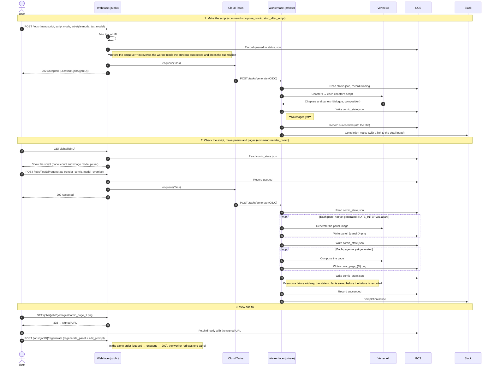

# 🎨 AP Story

[](https://github.com/shouni/ap-story/actions/workflows/ci.yml)
[](#)
[](https://go.dev/)
[](https://cloud.google.com/run)
[](https://opensource.org/licenses/MIT)

English | [日本語](README.ja.md)

## 🚀 About - check the script, then draw the panels and pages

**AP Story** is a service on Cloud Run + Cloud Tasks that generates comics from a manuscript.

It reads a manuscript (a URL or text) and, through [go-comic-kit](https://github.com/shouni/go-comic-kit)
operations, generates "chapters → name (script) → panel images → page images" as asynchronous jobs.
Artifacts and the state document (`comic_state.json`) live in GCS, and job progress
(`queued` / `running` / `succeeded` / `failed`) is recorded in `status.json` under the same prefix.

* **The script and the images are separate stages.** The web form makes only the chapters and the name;
  image generation starts on the work's detail page, once the panel count is visible.
* **Work can resume midway.** The state is saved at each break in the process, and `render_comic` fills in only
  the panels and pages not yet generated.
* **Panels and pages can be fixed one by one.** Rerolling the seed and edit instructions ("make the expression a smile")
  are enqueued as jobs.
* **Script dialogue can be fixed from the screen and the API.** Fixed dialogue appears in the art once the affected pages are recomposed.
* **People and machines use the same URLs.** Browsers use a Google OAuth session and AI agents use
  service-account OIDC (M2M), on the same routes, told apart by `Accept` and the shape of the body.
  The same API can also be called through the MCP gateway.

One image is deployed, by `SERVER_ROLE`, as **two services: the web face (public) and the worker face (private)**
(`cloudbuild.yaml`).

---

## 📦 Usage

### 1. Configuration

`ValidateEssentialConfig` validates only what each role needs.

**Required for every role**

| Variable | Description |
| --- | --- |
| `SERVER_ROLE` | `web` / `worker` / `both` (`both` is for local development). **Unset or unknown values are a startup error.** Only the faces the role serves are assembled, and only their routes are registered. |
| `GCP_PROJECT_ID` | GCP project ID. Gemini is called through Vertex AI. Running locally requires ADC. |
| `GCP_LOCATION_ID` | Region of the Cloud Tasks queue (e.g. `asia-northeast1`). There is no default; unset is a startup error. |
| `STORY_BUCKET` | GCS bucket **name** for artifacts, state and progress (without `gs://`; it is stripped if present). |

**Required on the web face (`web` / `both`)**

| Variable | Description |
| --- | --- |
| `GEMINI_MODELS` | Models for the script (chapters and chapter scripts). **Comma-separated, the head is the default**; the list becomes the form's options and the allowlist at enqueue. There is no default value. The worker does not read it (each job carries its own model names). |
| `IMAGE_MODELS` | Models for images (design sheets, panels, pages). Treated the same as `GEMINI_MODELS`. |
| `CLOUD_TASKS_QUEUE_ID` | Name of the queue to enqueue onto. |
| `WORKER_URL` | URL of the worker **service**. Do not include a path. |
| `TASK_CALLER_SERVICE_ACCOUNT_EMAIL` | The caller SA put on tasks. **Cloud Tasks issues the token**; this process signs nothing. |
| `GOOGLE_CLIENT_ID` / `GOOGLE_CLIENT_SECRET` | Google OAuth client. |
| `SESSION_FIRESTORE_DATABASE` / `SESSION_FIRESTORE_COLLECTION` | Firestore holding sessions (both default to `sessions`). Firestore is used only for sessions; job progress is in GCS. |
| `ALLOWED_EMAILS` / `ALLOWED_DOMAINS` | Who may log in (comma-separated). **If both are empty, the service does not start.** |
| `ALLOWED_M2M_SERVICE_ACCOUNTS` | SAs allowed when machines (such as the MCP gateway) call with an OIDC Bearer token (comma-separated). Empty means the service does not start. |

**Required on the worker face (`worker` / `both`)**

| Variable | Description |
| --- | --- |
| `TASK_AUDIENCE_URL` | Audience for OIDC verification. Unset, `SERVICE_URL` is used. When web and worker are split, it is **the URL of the worker, the callee**. |
| `ALLOWED_TASK_SERVICE_ACCOUNTS` | Caller SAs to accept (comma-separated). Specify the **enqueuing side's** SA. Web and worker run as separate SAs, so the worker lists "someone else's SA". |
| `TASK_DISPATCH_DEADLINE` | How long Cloud Tasks waits for the worker's response (e.g. `30m`; Cloud Tasks' own limit is also `30m`). **There is no default; unset fails startup.** |
| `PIPELINE_TIMEOUT` | Cap for one worker task (the whole stage sequence, script → panels → pages). **There is no default; unset, unlimited, or anything at or above `TASK_DISPATCH_DEADLINE` is refused at startup.** |

Three values decide the worker's run time, and this ordering must hold. The effective cap is **the smallest value**.

```
PIPELINE_TIMEOUT  <  TASK_DISPATCH_DEADLINE  <=  Cloud Run timeout
     (app)                  (task)                  (service)
```

None of the three has a default in the app; only the infrastructure's Terraform decides the values.

**Optional**

| Variable | Description |
| --- | --- |
| `SERVICE_URL` / `PORT` | Public URL and listening port (Default: `http://localhost:8080` / `8080`). `SERVICE_URL` is also the OAuth redirect target, the M2M audience and the source of Slack notice links, so **set the web URL on the worker too**. |
| `CHARACTERS_JSON_PATH` | go-character-kit's `characters.json` (GCS or local). Unset, go-character-kit's embedded default character definitions are used. |
| `IMAGE_ASPECT_RATIO` | Aspect ratio shared by panels, pages and design sheets (`1:1` / `3:4` / `9:16` / `16:9`). Unset means `3:4`. |
| `PANEL_IMAGE_SIZE` / `PAGE_IMAGE_SIZE` | Resolution of generated images (`1K` / `2K`). Unset means `1K` for panels and `2K` for pages and sheets. |
| `MAX_CHAPTERS` / `MAX_PANELS_PER_CHAPTER` / `MAX_PANELS_PER_PAGE` | Caps on chapters, panels per chapter and panels per page. Unset means go-comic-kit's defaults. |
| `MAX_CONCURRENCY` | Concurrency of batch generation (default `1` = sequential). |
| `RATE_INTERVAL` | Minimum interval between AI calls (Default: `10s`; `0` means unlimited). **Throughput is capped by 1/`RATE_INTERVAL`, not by `MAX_CONCURRENCY`.** With the defaults `compose_comic` makes up to 84 AI calls, which is at least 14 minutes even at `10s`, so before raising it check that it still fits within the three tiers above. |
| `REQUEST_TIMEOUT` | Cap for a single external AI call (Default: `5m`). One image takes tens of seconds, so anything below `2m` logs a warning at startup. |
| `SLACK_WEBHOOK_URL` | Where completion and failure notices go. Unset disables notices. Only the worker face uses it. |

> Environment variables hold only **settings decided by the deployment target**. Values that vary per work,
> such as the manuscript, modes and models, travel in the task payload (JSON) and are recorded in `comic_state.json`.

### 2. Startup

```bash
go run .        # SERVER_ROLE is required
```

Only the faces `SERVER_ROLE` serves are assembled.

| Role | What is assembled | Exposed routes |
| --- | --- | --- |
| `web` | Submission forms, the work and character screens, enqueueing onto Cloud Tasks, Firestore for sessions | `/`, `/compose/*`, `/comic-options`, `/jobs/*`, `/characters/*`, `/auth/*` |
| `worker` | The pipeline (go-comic-kit + Vertex AI + GCS + notices) | `POST /tasks/generate` |
| `both` | Both (for local development) | All of the above |

In production one image is deployed as two Cloud Run services (`cloudbuild.yaml`).
The worker's ingress is `internal`, so only Cloud Tasks can reach it, and it runs as a different SA from the web.
The SA and IAM definitions live in the infrastructure's Terraform.

Running `go run .` with `SERVER_ROLE=both` lets you see the screens, but **Cloud Tasks cannot deliver to
localhost, so enqueued jobs never run on the worker.** Verify logic with `go test ./... -race`.

### 3. HTTP endpoints

**There is one authentication.** `auth.Protected` accepts both an OIDC Bearer token and a session, so
people and machines can call the same URLs. Only `GET /health` and `/static/*` sit outside authentication,
and they are registered regardless of role.

| Method | Path | Purpose |
| --- | --- | --- |
| `GET` | `/health` | Health check (`/healthz` is not used, because Cloud Run's default domain treats it as a reserved path and it never reaches the container). No authentication |
| `GET` | `/static/*` | The embedded CSS / JS and Bootstrap / Bootstrap Icons under `vendor/`. No authentication. `vendor/` is `public, max-age=31536000, immutable`; the app's own assets are `public, max-age=300, must-revalidate` |
| `GET` | `/auth/login` `/auth/callback` `/auth/logout` | Google OAuth login, callback and logout |
| `GET` | `/` | Home page (shows a few recent works) |
| `GET` | `/compose` | Script generation form. Choose the script mode, art-style mode and text model. **The image model is chosen on the work's detail page** |
| `GET` | `/compose/design-sheet` | Standalone design-sheet form. `?character_id=` preselects a character |
| `GET` | `/comic-options` | The script modes and art-style modes (with descriptions of their use) and model lists (the head is the default) a generation job can specify. It is the allowlist at enqueue itself, the same content as the form's `<select>` |
| `POST` | `/jobs` | Enqueue a job. A form body is the screen, a JSON body a machine. `command` is `compose_comic` (when omitted) or `generate_design_sheet`. The server mints the job ID. Accepted with `202` and `Location: /jobs/{jobID}` |
| `GET` | `/jobs` | Works (`compose_comic` jobs), newest first. `?page=` (20 per page). Browsers get the list page, `Accept: application/json` gets the list of states |
| `GET` | `/jobs/{jobID}` | One job, at the same URL from enqueue to delete. Browsers get the detail page (panel and page generation buttons, the script tab, individual regeneration). JSON gets the progress and, when the state can be read, the contents of `comic_state.json` under `comic`. Design-sheet jobs get the progress only |
| `DELETE` | `/jobs/{jobID}` | Delete all artifacts together (`204`). The screen's delete button also sends DELETE via fetch |
| `GET` | `/jobs/{jobID}/script` | Returns only the editable part of the script (chapter headings and each panel's dialogue). No generation records or prompts |
| `PUT` | `/jobs/{jobID}/script` | Save the script. Only the dialogue's text, speaker and kind can be replaced; **adding, removing or reordering panels is rejected.** The pages to recompose are returned in `affected_pages`. `409` while the job is `queued` / `running` |
| `POST` | `/jobs/{jobID}/regenerate` | Enqueue a regeneration job (a `command` other than `compose_comic`, and its parameters). The URL's `job_id` is used and the body's value is ignored. `202` and `Location` |
| `GET` | `/jobs/{jobID}/images/*` | Redirect (302) to a signed URL of a panel or page image |
| `GET` | `/characters` | Character list. Browsers get thumbnails of the master reference images; JSON gets id, name and reference_url (image URLs stay `gs://`) |
| `GET` | `/characters/{characterID}` | Character detail. Browsers get the master reference images per size / aspect ratio and the latest 12 design-sheet generations; JSON gets the whole generation history (newest first) |
| `GET` | `/characters/{characterID}/design-sheets` | The whole design-sheet generation history (newest first, with delete buttons) |
| `DELETE` | `/characters/{characterID}/design-sheets/{jobID}` | Delete one design-sheet generation record. For a standalone job the state is deleted too; for a comic job only the reference inside the state is removed |
| `GET` | `/characters/images/*` | Redirect to a signed URL of a design-sheet history image |
| `GET` | `/characters/reference/*` | Redirect to a signed URL of a character's master reference image |
| `POST` | `/tasks/generate` | The Cloud Tasks-only worker. A request that fails OIDC verification gets 401; with `SERVER_ROLE=web` **the route is not registered at all**, so 404 |

**One resource, one route.** The representation is decided by `Accept`: send `application/json` and you get
JSON, send a browser's `Accept` and you get a page. Paths follow the URL naming convention in public-docs.

**Methods with side effects need a CSRF token.** Forms send it in the hidden `csrf_token` field and the
screen's JS in the `X-CSRF-Token` header. Machines authenticated with an OIDC Bearer token skip this check;
instead, callers are restricted by `ALLOWED_M2M_SERVICE_ACCOUNTS`.

Validation of the script mode, art-style mode and models (a value not listed by `GET /comic-options` is a 400)
goes through the same function for the screen and the API.

**Generating from the screen**

1. Submit the manuscript at `/compose`, choose the script mode, art-style mode and text model, and press "台本を生成" (generate script).
   **This form makes only the chapters and the name** (`stop_after_script` is always set).
2. Check the script at `/jobs/{jobID}`, then **choose the image model and press "コマを生成" (generate panels)**. You can start with the
   whole work or, from a chapter card, with a single chapter. If it fails midway, "続きのコマを生成" (generate remaining panels) fills in only what is missing.
3. Once the panels are all there, the button in the same place changes to "ページを合成" (compose pages).
4. Fix individual panels and pages you do not like from the detail page. Shuffle (`bi-shuffle`) rerolls the
   seed and the pencil (`bi-pencil`) makes a partial edit by instruction (it takes the generated image as input, so it is
   not shown for panels not yet generated). "台本を再生成" (regenerate script) on a chapter heading remakes only that chapter's name
   (its panels have to be remade).
5. Touch up dialogue in the "台本" (script) tab. Saving returns the page numbers that need recomposing, so
   remake those pages with "ページを合成".

### 4. Task payload

Tasks received by the worker branch on `command`. Each command takes the form "load the state →
run the go-comic-kit operation → save the state", and `render_comic` skips panels and pages already generated.

| `command` | What it does | Required fields |
| --- | --- | --- |
| `compose_comic` | Chapters → each chapter's script → every panel → every page. `stop_after_script` stops after the script. Design sheets are not included | `source_url` or `source_text` |
| `render_comic` | Generates only the panels and pages not yet generated. It is both the continuation after checking the script and the resume after a failure or cutoff. `chapter_id` narrows it to that chapter, `stop_after_panels` to panels only | `job_id` |
| `regenerate_chapter_script` | Remakes one chapter's script (the following panels and pages are regenerated separately) | `job_id`, `chapter_id` |
| `generate_design_sheet` | Generates a character design sheet | `character_ids` |
| `regenerate_panel` | Generates / regenerates one panel | `job_id`, `panel_id` |
| `regenerate_page` | Composes / recomposes one page | `job_id`, `page` |

| Field | Description |
| --- | --- |
| `command` | One of the six above. `POST /jobs` accepts `compose_comic` (may be omitted) and `generate_design_sheet`; `POST /jobs/{jobID}/regenerate` accepts the rest. |
| `job_id` | The job's identifier. For `POST /jobs` the server mints it; for `regenerate` the URL's is used. It also decides where the artifacts go. |
| `source_url` / `source_text` | The manuscript for `compose_comic`. Exactly one of them. |
| `script_mode` / `style_mode` | The script mode (`.md` files in `assets/prompts/outline` and `chapter`; the file name is the mode name) and the art-style mode (`assets/prompts/styles.json`). Listed by `GET /comic-options`. |
| `text_model` | The model that writes the script. Empty means the head of `GEMINI_MODELS`. The JSON of `POST /jobs` also accepts `image_model`, which becomes the task's `model_override`. |
| `model_override` | The model that draws panels, pages and design sheets. Empty means the head of `IMAGE_MODELS`. **It is recorded on the work at the first image generation and becomes the default from then on.** |
| `stop_after_script` / `stop_after_panels` | Stop after the script / after the panels. A `compose_comic` from the form always carries the former. |
| `chapter_id` / `panel_id` / `page` | The target chapter (`ch01`) / panel (`ch01-p03`) / page number (1-based). |
| `character_ids`, `aspect_ratio`, `layout`, `reference_url_override`, `visual_cues_override` | Input to `generate_design_sheet`. `aspect_ratio` defaults to `16:9`. The two overrides apply only when a single character is given. `layout` is empty (three-view turnaround), `single` (one full-body pose, a reference anchor), or one of the supplementary sheets `expressions` / `outfit` / `parts`, which take one character at a time; anything else is a 400. A character with no `reference_url` is drawn from her `visual_cues` alone (a new character's first sheet). |
| `seed` / `edit_prompt` / `prompt_override` | Generation conditions for `regenerate_panel` / `regenerate_page` / `generate_design_sheet`. Omitting `seed` reuses the previous generation conditions, and adding `edit_prompt` makes it an edit that takes the generated image as input. |

The choices of script mode, art-style mode and models are recorded in `comic_state.json`, and **jobs run later
inherit them.** `render_comic` after checking the script, remaking a chapter's script, and regenerating panels and pages
all use the recorded choices, so one work never switches to a different model or art style midway.

```json
{
  "command": "compose_comic",
  "source_url": "https://example.com/story",
  "script_mode": "default",
  "style_mode": "default",
  "text_model": "<one of GEMINI_MODELS>",
  "image_model": "<one of IMAGE_MODELS>",
  "stop_after_script": true
}
```

```json
{
  "command": "regenerate_panel",
  "panel_id": "ch01-p03",
  "edit_prompt": "make the expression a smile"
}
```

**GCS layout**

```
gs://{STORY_BUCKET}/
├── comics/{jobID}/                    # prefix per comic job
│   ├── comic_state.json               # MangaState (the history and detail pages read this)
│   ├── status.json                    # progress (queued / running / succeeded / failed)
│   └── images/
│       ├── panel_{panelID}.png        # panel image (stable path tied to the panel ID, overwritten)
│       └── comic_page_{N}.png         # page image
├── design-jobs/{jobID}/
│   └── comic_state.json               # state of a standalone design-sheet job (images are under character/)
├── character/{tag}/{jobID}.png        # design sheet (a shared asset independent of any work)
└── character-reference/{characterID}/... # hand-prepared master reference images
```

`{tag}` is the character ID (for a composed sheet, several IDs joined), and `{jobID}` is unique per
generation call, so regenerating the same character never overwrites past results. The history list is
a listing of `comics/*/comic_state.json`; standalone design-sheet jobs appear under `/characters/{characterID}`.
Images are never served by the app directly; it 302-redirects to a signed URL.

---

## 🔄 Sequence diagram



## 🌳 Project structure

```text
ap-story/
├── main.go                  # entry point (starts the server)
├── Dockerfile               # scratch image (static binary only)
├── cloudbuild.yaml          # build and deploy to the two services
├── assets/                  # embedded (prompts/outline and chapter *.md, prompts/styles.json, templates/*.html, static/)
└── internal/
    ├── config/              # loading environment variables and per-role validation
    ├── server/              # chi router, graceful shutdown
    │   └── handlers/        #   the web face (submission forms, work and character screens, script editing, image redirects)
    ├── domain/              # Task and commands, job IDs, progress, port definitions (Pipeline / TaskQueue / ComicRepository / Notifier / JobStatusStore)
    ├── app/                 # DI container
    ├── builder/             # assembling external dependencies and handlers (per role)
    ├── repository/          # reading and writing comic_state.json and status.json, history list, deletion
    ├── pipeline/            # the worker itself: the Runner in pipeline.go builds the Lifecycle, planner.go picks the stage sequence from the command, and each stage is a step_*.go
    └── adapters/            # go-comic-kit Operations / Cloud Tasks / Slack / characters.json / prompts (prompts/)
```

---

## 📜 License

* This project is released under the [MIT License](https://opensource.org/licenses/MIT).
